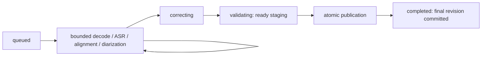

# Transcript states and retry

This guide describes the implemented transcription services as of 2026-10-09.
Live text, staged final text and a committed final revision are distinct results.
The last committed transcript stays readable until a complete replacement commits.
A processing error never means that final transcription succeeded.
If there is no previous text, show the pending/error state and retain available
audio for processing; an empty reading area is not proof of final completion.

Native capture normalization, Stop-to-job wiring, durable live-head publication
and the complete meeting workspace remain tasks 4.4, 4.6 and 9. The current
capture diagnostic saves metrics only. The service and synthetic-fixture behavior
below does not establish a complete native recording workflow.

## Text and speaker status

| Result | Text and timing | Speaker meaning |
| --- | --- | --- |
| Live (`TranscriptKind.live`) | Rolling, revisable wording; coarse source-window times. Growing recognition can update the same row ID. | `VoiceN` is a provisional candidate within the meeting/capture day. `Voice1 / Voice2` expresses mixed or uncertain ownership. It does not identify a person. |
| Final staging (`FinalTranscriptionCheckpoint`) | Saved original ASR, aligned original words, speaker candidates and accepted indexed corrections. `run` saves complete staging at `validating`; a retained ready flag is not a published result. | System candidate UUIDs are unconfirmed. The staging helper label is `Unconfirmed system speaker`; these candidates are reconciled at publication. |
| Published final (`TranscriptKind.final`) | A validated immutable revision is the affected recording's transcript head; its job is `completed`. Original words/timing remain alongside corrected display text. | Day-scoped identities and assignments are committed. Unknown voices keep numbered labels; uncertain confirmed-name matches have durable review records. Final text may be complete while names still need review. |

Microphone speech always remains `You`, including during correction, reruns and
name reconciliation. `Voice1` on another day or in another meeting is a different
scope. Numbering and similar text never establish identity. Publication preserves
a confirmed name only when compatible clean voice evidence and same-source time
correspondence agree. Splits, merges, mixed speech and uncertain matches remain
unknown for review.
The native day-name dialog is implemented and checked with a signed synthetic
fixture. It uses final
system identities only, shows meeting/day scope and preserves source text.
The dialog now offers initially-off Remember voice with new/existing profile
selection. It commits the day name first, then verifies suitable system audio;
insufficient speech or cancellation retains the name with an explanation. See
[remembered voices](voice-profiles.md).
The recognition service now compares compatible saved voices after final
publication and commits an automatic name with immutable matching proof. Native
labels identify automatic names; a manual correction takes precedence and does
not train unless Remember voice is explicitly enabled. Recognition leaves source
text and speaker IDs intact. No production calibration is bundled yet, so the
default service returns `uncalibrated` before loading any models. Calibration,
the full workspace, reconciliation-review UI and job wiring remain pending.

## Live status

`LiveTranscriptionState` belongs to the live session, not the final-processing job.
The reusable view labels every live row `Provisional`.

| State | Meaning and recovery |
| --- | --- |
| `preparing` | Initial presentation while attaching the session. It is not a capture-success signal. |
| `disabled` | Live transcription is off. The recording writer remains independent. |
| `unavailable` | Required live models were not supplied. Install/repair them before a new session; capture must remain independent. |
| `ready` | Live processing is available; all text and speaker candidates remain provisional. |
| `paused` | Live input is paused. Resume starts a new capture boundary and resets overlap context. |
| `delayed(skippedWindows:)` | Obsolete live requests were replaced by newer bounded windows. Saved audio is not discarded; final processing uses it. |
| `failed(track:message:)` | A source's live window failed. Earlier rows stay available and later windows retry automatically. |
| `stopped` | `finish()` drained the bounded tail, or `cancel()` invalidated pending work. This state does not report a completed final transcript. |

The existing ready message is `Live transcript · provisional text and speakers`.
A successful later window can move the state away from `failed`, while
`lastFailureMessage` remains available to the presentation, including after Stop.
Do not hide an outstanding issue solely because another window succeeded.

`append` does not await inference. At most one active window and one newest
pending window per track are retained. Live failure/backlog does not authorize
dropping durable audio. The injected dual-AAC fixture verifies independent writer
retention; production native writer wiring is still pending. Model changes and
language/default edits do not alter an existing session's options/snapshots.

## Final job stages

`ProcessingJob.stage` describes durable work. The processing entry point is
`FinalTranscriptionPipeline.runAndPublish(jobID:)`. Its `run(jobID:)` method stops
at staging and must not be used as a final-success signal.

| Stage | Implemented final-processing meaning |
| --- | --- |
| `queued` | A persisted immutable job is eligible to run. Queueing alone does not start inference or prove that models are ready. |
| `waitingForModels` | At least one required pinned model is unavailable. No automatic download occurs. Repair/install the required revision, then retry. |
| `decoding` | Checkpoint/source validation and bounded committed-AAC reading, including explicit gaps. |
| `transcribing` | Stronger final ASR is running for a bounded window. |
| `aligning` | Original ASR is checkpointed; original-word alignment is pending/running. |
| `diarizing` | Alignment is checkpointed; system-speaker processing/block construction proceeds. Microphone speech bypasses speaker inference. |
| `correcting` | Indexed batches are checked for complete IDs, source coverage and protected facts. Accepted batches are checkpointed. |
| `validating` | Complete staging is ready for publication. Existing visible text is still the previous revision. This is not success. |
| `completed` | The publication transaction committed the revision, speaker provenance, affected head and job completion together. |
| `failed` | Staging raised a non-cancellation error; previous text/audio and the last durable checkpoint remain. Inspect the error before retrying. |
| `interrupted` | Staging was task-cancelled, or unfinished active work was found when opening the store. It can be retried if its source remains valid. |
| `cancelled` | Explicit meeting-job invalidation cancelled unfinished jobs, or the user pressed Cancel in the status row. The old snapshot cannot be retried; a later operation needs a new job. A recording with an earlier completed final job still shows `Transcript ready`. |

Decoding/ASR/alignment/diarization repeat for each source window; stages are not
monotonic percentages. `generating` and `publishing` exist in the shared enum,
but this final pipeline does not persist them. In particular, do not set
`publishing` before calling `publishFinalTranscript`: it expects `validating`.



`runAndPublish` propagates publication errors. An aborted publication transaction
leaves the job at `validating`, the ready checkpoint intact and the previous head
unchanged. Cancellation after staging can also leave `validating` until recovery.
Likewise, recording an error stage is best-effort if storage itself is failing.
Callers must surface the thrown error even when the last saved stage looks active.
Neither a ready flag, model output nor a `validating` stage justifies showing
final processing as successful. The complete final-status UI remains task 9.

A publication can commit with unknown names and review requests: uncertainty
about a name is separate from incomplete/invalid text. Repeating publication of
an already completed job returns its original artifact and does not replace a
newer head again. Low-level `publishTranscript` is retained for persistence
fixtures; application final processing must consume validated staging.

## Progress, estimate and queue

The workspace shows final transcription from the runner, not from the stored
stage, which is saved only every few seconds:

- **Progress.** `FinalTranscriptionPipeline` reports `FinalJobProgress` after
  every window step (in memory, no database writes): weighted audio seconds,
  system audio fully and microphone audio by 0.1, because most microphone windows
  skip recognition. A resumed checkpoint's windows count as processed but not as
  measured. `FinalJobRunner` forwards these as `progress` events.
- **Status row.** While the selected meeting's job runs, the row reads
  `Transcribing…` with a bar over the meeting's run of work (earlier finished
  recordings, the running one and its queued ones) and `about N min left` or
  `less than a minute left`. Correction and saving keep their own messages.
- **Estimate.** `FinalTranscriptionEstimate` measures from the job's first report
  (loading models and the first window are not extrapolated). It starts from the
  stored `finalTranscriptionRate` preference (default 0.14 s per weighted second)
  and moves linearly to the job's own rate over the first 10 % of its new audio,
  adding 5 s per job for correction and saving. Minutes round up and rise only
  when the estimate exceeds what is shown by half a minute. A completed job with
  at least 30 s of measured audio averages its rate into the preference. The
  estimate is approximate and corrects itself as the job runs.
- **Queue.** `SessionStore.finalQueue()` lists final jobs of all meetings in
  runner order. Only the runner's current job counts as running; a job left in
  `validating` by a failed publication neither runs nor waits. A meeting behind
  another shows `In queue: 2nd, after “Daily 5”` with a clock icon, or
  `Waiting to transcribe` with nothing ahead (for example while recording).
  Sidebar rows show `waveform` (running) or `clock` (queued) with accessibility
  labels.
- **Cancel.** In place of Reprocess while queued or running.
  `SessionStore.cancelFinalTranscription(meetingID:)` marks the meeting's queued
  and running final jobs `cancelled`, then the runner cancels the running task;
  summaries, translations, audio and published transcripts stay, and the
  cancellation generation is unchanged. Quitting still interrupts and requeues
  the running job instead.
- **Layout.** The row reserves the height of its small buttons in every state,
  so the transcript below does not move when they change.

## Retry and relaunch

| Situation | Action and retained data |
| --- | --- |
| Live window error/backlog | Let later live windows proceed. Earlier provisional text and independently written audio remain; live recovery is not final-job completion. |
| `failed`, `interrupted`, `waitingForModels` with an unchanged source | Resolve the cause, call `SessionStore.retryJob(id)` to return the same job to `queued`, then run `runAndPublish`. The original settings/models and checkpoint are retained. |
| Publication write failure in the same store session | Resolve the write failure and retry `publishFinalTranscript(jobID:)` while the job remains `validating`. No new inference is needed for that intact ready artifact. |
| Relaunch after unfinished processing or staging | Store opening marks active unfinished stages `interrupted`; `queued`, `waitingForModels`, `completed`, `failed` and `cancelled` retain their states. Retry and revalidate before publishing; never publish a recovered ready flag directly. |
| Explicit cancellation | `cancelJobs(meetingID:)` invalidates all unfinished jobs for that meeting and increments its cancellation generation. Worker cancellation/join is a separate caller responsibility. Start a new job for a new explicit request. |
| Changed recording, superseded affected transcript, incompatible checkpoint/prompt version or unknown model snapshot | Keep the audio/last revision; create a fresh job from the current source after resolving compatibility. Never rewrite an old snapshot to force retry. |
| Deleted meeting | Reject late work. Deletion is authoritative; processing must not recreate the meeting. |

A resumed final run rechecks recording fingerprints, AAC receipts, source/window
ownership, checkpoint version and correction prompt version. It clears staging
readiness before this validation. Completed ASR/alignment/speaker work and
accepted correction batches are reused; failed unfinished work is retried.
Checkpoint content and its job-stage change commit together in SQLite.

Final retries use the affected recording's generation, cancellation generation
and transcript head. Editing notes or meeting-language defaults does not retarget
that frozen final job; a newer affected transcript or changed audio does. The
latest confirmed speaker assignments are read inside the publication transaction.
Changing model/default/context settings applies to new jobs. New text jobs use
the selected Qwen3.5-9B OptiQ revision; historical 35B snapshots remain exact.
Context is 32K by default, with 64K maximum selectable. A budget or memory refusal
preserves source text and audio; it never clips input or silently lowers context.
A different budget/model requires a new job. See [inference policy](inference.md).

## Examples tied to fixtures

These are specific fixture outputs/assertions, not claims of recognition quality
on arbitrary meetings.

The live English refinement fixture updates one row, retaining its ID, provisional
speaker and coarse timestamp. The second text appears before Stop:

```text
Today we discussed the project. The next meeting
Today we discussed the project. The next meeting will be on Friday.
```

The deterministic Russian final fixture corrects `завтро` to `завтра` while keeping
Алексей, `не`, `42` and its microphone provenance. Its staged block is:

```text
Алексей не заплатит 42 рубля завтра
```

The actual offline 9B final fixture returns this already-correct English system
block unchanged, with exact ordered correction IDs and a ready checkpoint:

```text
Alex will not approve forty-two items today. Maria will review version seventeen tomorrow. We will keep the original recording.
```

This actual probe finishes staging, retains the previous visible transcript and
restores an identical checkpoint after reopen. It does not itself publish a new
head. The separate publication fixture proves the change from `validating` to
`completed` and replacement of only the affected recording.

The formatter fixture uses the frozen Asia/Tokyo capture day and always renders
the microphone as `You`, even when a named system speaker is supplied:

```text
[09:00:00]: You - Voice1 said no 42.
```

Every recording starts with its own separator showing its capture-time date and
start time; same-day recordings are separated too, without `resumption`. The
midnight/resumption fixture (one recording crossing midnight, then one three days
later) emits these exact separators, in this order:

```text
------------ [September 24, 2026 · 23:59] ------------
------------ [September 25, 2026] ------------
------------ [September 27, 2026 · 23:59] resumption ------------
```

A recording with saved audio but no text keeps its place in capture order as a
separator with a note: `Recording…`, `Not transcribed`, `Transcription failed`
or `No speech found` (`SessionStore.meetingTranscript`, `emptyNotes`). In the
Transcript tab a recording's separator carries its trash button (see
[storage](storage.md#deleting-one-recording)).

Same-speaker speech merges at exactly 2.000 seconds; 2.000001 seconds starts
another block. Different speakers, recordings and capture days remain separate;
wall-clock pauses also split blocks. Corrected display text never erases original
ASR or invents new word timestamps.
